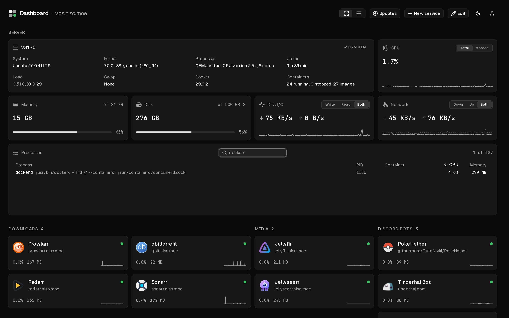
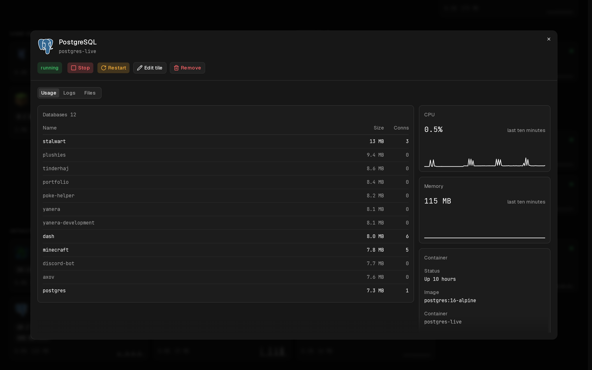
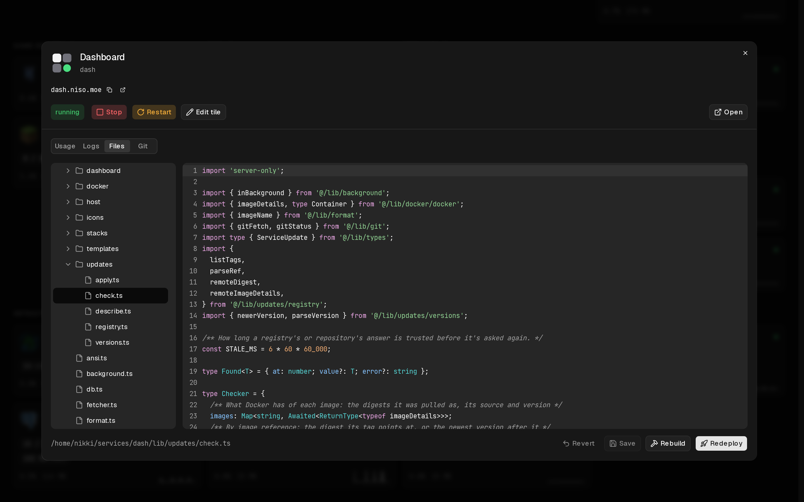
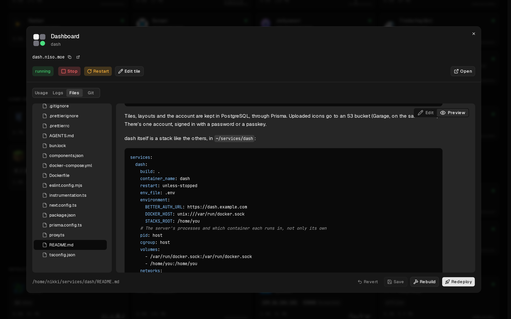
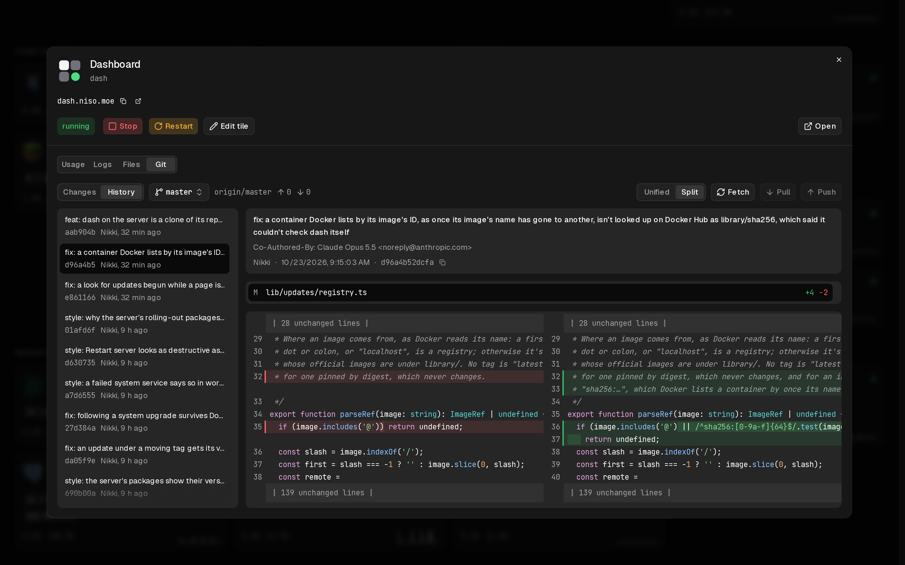
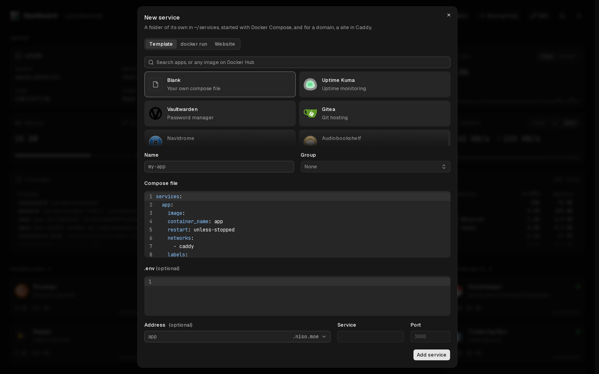
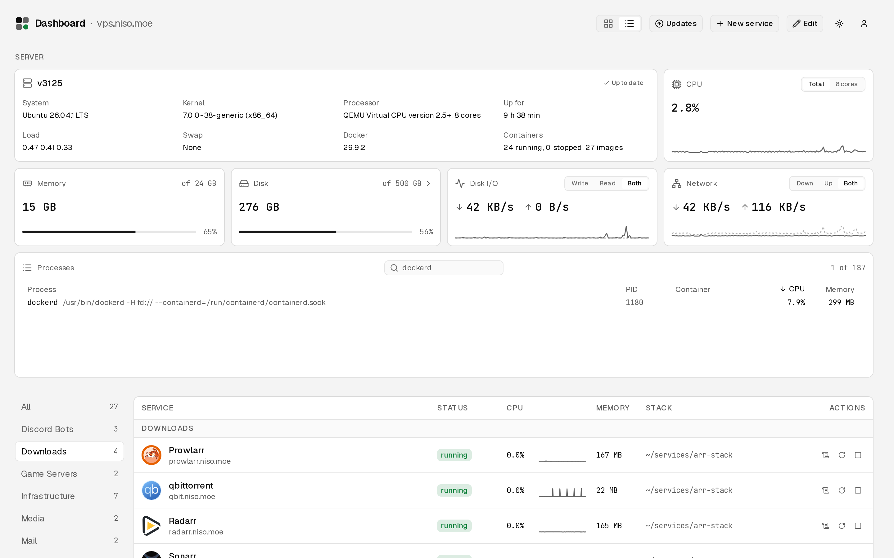

# dash

**A dashboard for one home server, that runs on it.** Every Docker container
as a tile, with its status, usage and live numbers, and a window to run it
from: logs and console, its files in an editor, its git history, and one click
to redeploy. New services come from templates and get a site in Caddy.



- **Everything on the server, at a glance.** CPU, memory, disk, network and
  processes, then every container in groups, each with a sparkline and the
  numbers its app knows: downloads in qBittorrent, players on Minecraft, sites
  in Caddy.
- **A window for each service.** Start, stop and restart it, read and type
  into its logs, edit its compose file and `.env` (checked by Compose before
  they're saved), and see what its app has to say.
- **Git, built in.** Changes, commits, branches and history, with diffs side
  by side, for every stack that's a repository, dash's own included.
- **New services in a minute.** About 200 templates, any image on Docker Hub,
  a `docker run` command or a compose file of your own. dash makes the folder,
  starts it, writes its Caddy site and reloads Caddy, and undoes it all if a
  step fails.
- **Updates, found and applied.** New image versions and new commits,
  checked every few hours, and applied from the dashboard: one service, or all
  of them. The server's own packages too.

## A closer look

### A service's window

CPU and memory over the last ten minutes, its container's details and ports,
and what its app reports: here, PostgreSQL's databases.



### Its files, in an editor

The stack's folder as a tree, with files created, renamed and deleted there,
and opened in an editor with highlighting for TypeScript, YAML, Dockerfiles,
shell, TOML, `.env` and more. **Redeploy** runs `docker compose up -d` with
what was just saved; **Rebuild** builds it again first.



### Markdown, previewed

A README opens as GitHub would show it: headings, tables, task lists, and code
blocks colored as their language is in the editor.



### Its history, side by side

Each commit's message and files, and each file's changes either unified or
side by side, unchanged lines folded away. Fetch, pull and push are a click
each, and a stack that's behind its branch shows as an update on the
dashboard.



### Adding a service

Pick a template, search Docker Hub, paste a `docker run` command or write a
compose file. Give it an address, and its Caddy site is written for you.



### Light or dark, tiles or a list

Every view in either theme, as the system has it or picked by hand. The list
puts each service on a row, filtered by group.



## Apps it knows

Tiles show live numbers for Sonarr, Radarr, Prowlarr, Jellyfin, Jellyseerr,
qBittorrent, Gluetun, FlareSolverr, Stalwart, Minecraft, PostgreSQL, Garage,
Caddy and the stream relay. An app is known by its image's name, or by a
`dash.app` label on its container. Everything else gets the same tile, without
the numbers.

A container's tile starts from its [Homepage](https://gethomepage.dev) labels
(`homepage.name`, `homepage.icon`, `homepage.group`, `homepage.description`,
`homepage.href`) until it's edited in dash, so a server already set up for
Homepage looks right from the start.

## How it fits together

dash is a Next.js app. On the server it has the Docker socket and the home
folder mounted at the same path as on the host, so it can list and run
containers and reach their files where Compose expects them. It runs Compose
and git in short-lived containers of the official images, so its own image
needs neither.

It expects the server laid out like this:

```
~/services/
  <name>/            one folder per stack: its compose file, .env and data
  caddy/
    Caddyfile        import sites/*.caddy
    sites/<name>.caddy
```

Tiles, layouts and the account are kept in PostgreSQL, through Prisma.
Uploaded icons go to an S3 bucket (Garage, on the same server). There's one
account, signed in with a password or a passkey.

dash itself is a stack like the others, in `~/services/dash`:

```yaml
services:
  dash:
    build: .
    container_name: dash
    restart: unless-stopped
    env_file: .env
    environment:
      BETTER_AUTH_URL: https://dash.example.com
      DOCKER_HOST: unix:///var/run/docker.sock
      STACKS_ROOT: /home/you
    # The server's processes and which container each runs in, not only its own
    pid: host
    cgroup: host
    volumes:
      - /var/run/docker.sock:/var/run/docker.sock
      - /home/you:/home/you
    networks:
      - caddy

networks:
  caddy:
    external: true
```

With no account yet, it prints a setup code in its log; make the account at
`/setup` with it.

> [!WARNING]
> dash has the Docker socket and the server's processes, so whoever signs in
> to it controls the server. Keep it behind HTTPS, and use a passkey or a
> strong password.

## Developing

You need [Bun](https://bun.sh) and SSH access to the server (as `vps.niso.moe`,
set in `scripts/`, so a user name other than this machine's goes under
`Host vps.niso.moe` in `~/.ssh/config`). In development dash still works on
the real server: its containers, files and database.

1. Install, and copy the settings. Each setting in `.env.example` says where
   to find its value.

   ```bash
   bun install
   cp .env.example .env.local
   ```

2. Once, on the server, start the helper container that lets dash read the
   server's CPU, memory and processes from outside it, and set
   `HOST_HELPER_CONTAINER=dash-dev-stats`:

   ```bash
   docker run -d --name dash-dev-stats --pid host --restart unless-stopped alpine:3.22 sleep infinity
   ```

3. Open the tunnels to the server's Docker and to the apps whose numbers show
   on tiles, in a terminal of their own, and leave them running. Then start
   dash and open http://localhost:3000.

   ```bash
   bun run tunnels
   bun dev
   ```

## Deploying

On the server, `~/services/dash` is a clone of this repository, following
`master`, like the other projects there. Once commits are pushed, dash shows
an update for itself, and its Update pulls them and rebuilds it, restarting
dash. `bun run deploy` does the same from here: it pushes `master` (with no
uncommitted changes), then pulls and runs `docker compose up -d --build` on
the server. The server's `.env` stays where it is and is never in the
repository. Database changes go in with `bun run db:migrate`.

## Scripts

| Script                 | What it does                                             |
| ---------------------- | -------------------------------------------------------- |
| `bun dev`              | The development server                                   |
| `bun run tunnels`      | Tunnels to the server's Docker and apps, for development |
| `bun run deploy`       | Pushes master, then pulls and rebuilds it on the server  |
| `bun run typecheck`    | Type-checks the app and the scripts                      |
| `bun run lint`         | ESLint, Tailwind classes included                        |
| `bun run lint:classes` | Tailwind classes that have a shorter way to be written   |
| `bun run format`       | Prettier                                                 |
| `bun run db:diff`      | The SQL that would bring the database up to the schema   |
| `bun run db:migrate`   | Applies migrations                                       |

## Where things are

```
app/          pages and API routes
actions/      server actions, the changes a page asks for
components/
  auth/         sign-in and setup
  chrome/       the page's own: its name, theme and account menu
  dashboard/    tiles, the list, the board they're arranged on
  service/      a service's window: logs, details, status
  new-service/  adding a service, and its templates
  editor/       the file tree, code editor and Markdown preview
  git/          changes, history, branches and diffs
  host/         the server's stats, processes and disk
  updates/      finding and applying updates
  charts/       graphs and sparklines
  common/       scroll fades and loading placeholders
  ui/           buttons, dialogs, inputs and the rest
lib/          what runs on the server, and what the browser shares with it
  apps/         each app's widget and details: Jellyfin, Sonarr, Minecraft, …
  auth/         sign-in, sessions and setup
  dashboard/    the tiles, their groups, layout and status, websites' checks
  docker/       Docker's API, Compose, and runs in short-lived containers
  host/         the server's stats, processes, disk and files
  stacks/       adding and removing services, Caddy and domains
  templates/    the templates, Docker Hub search and docker run import
  updates/      checking registries and repositories, and applying updates
  icons/        finding icons
prisma/       the database schema and migrations
scripts/      deploy, tunnels and the class check
docs/         the screenshots here
```
