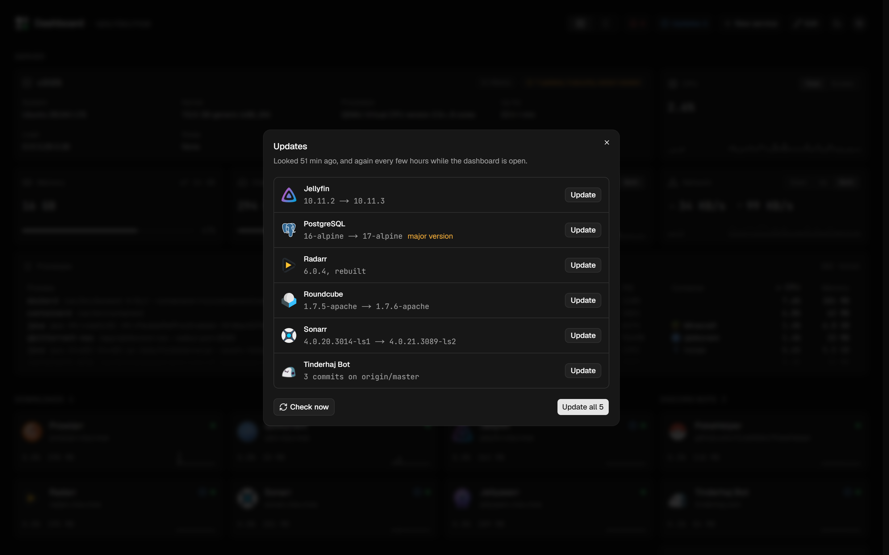
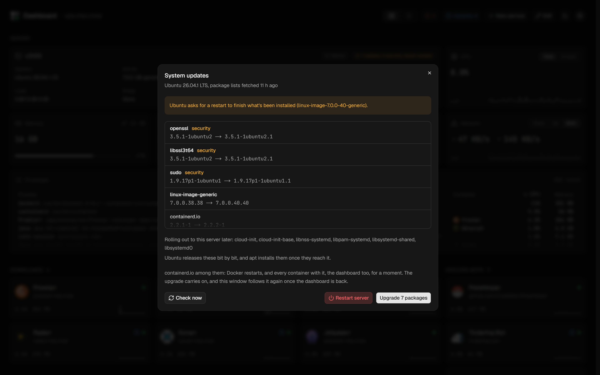
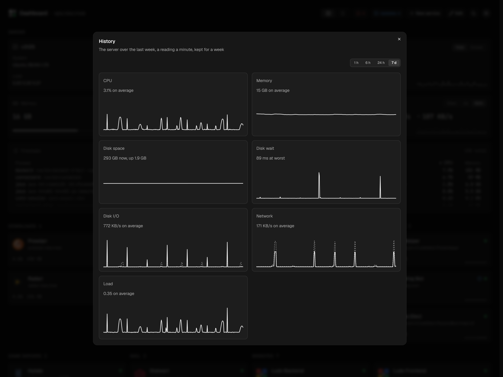
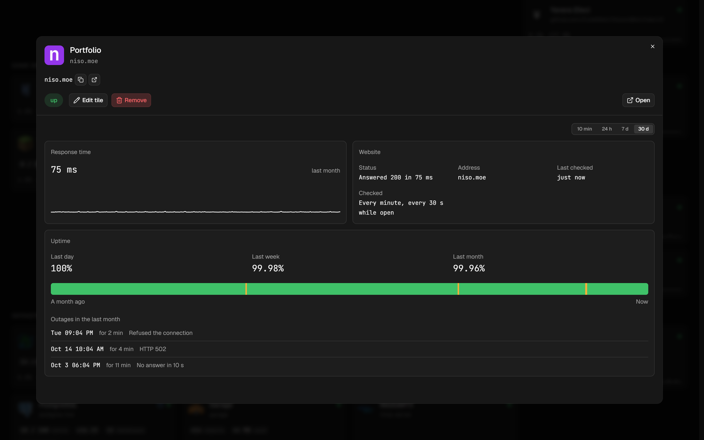
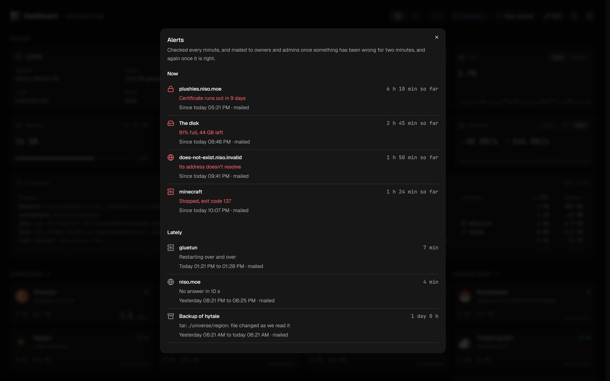
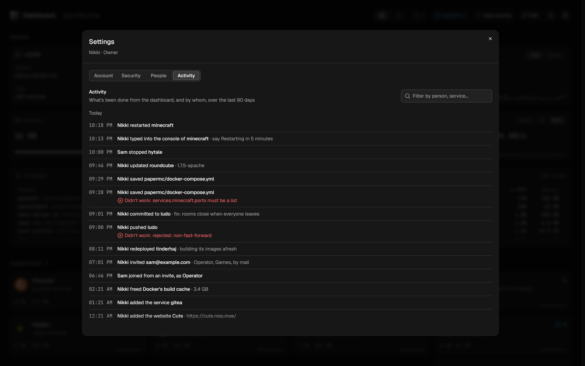
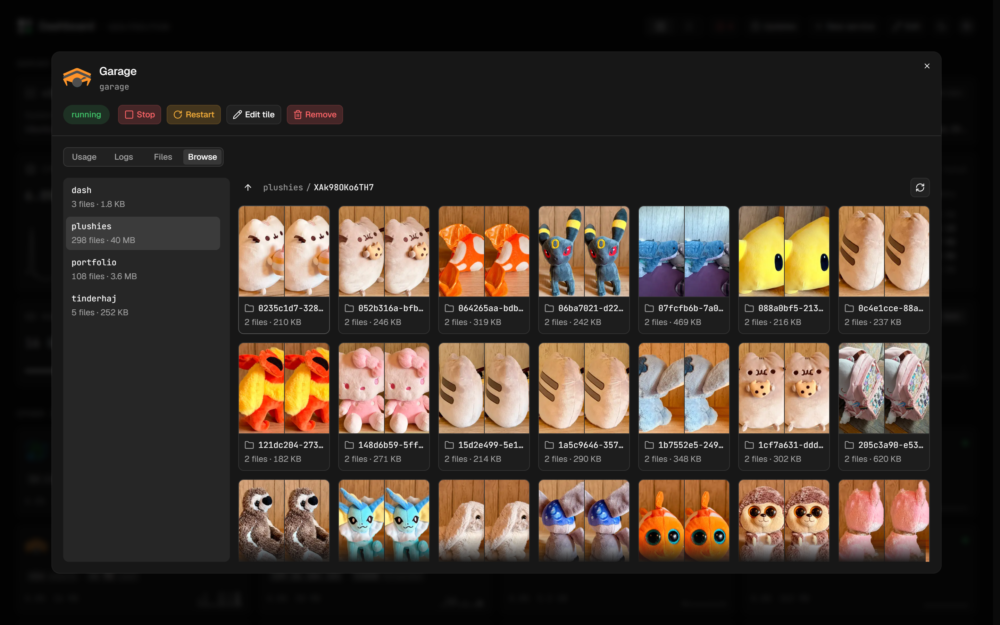
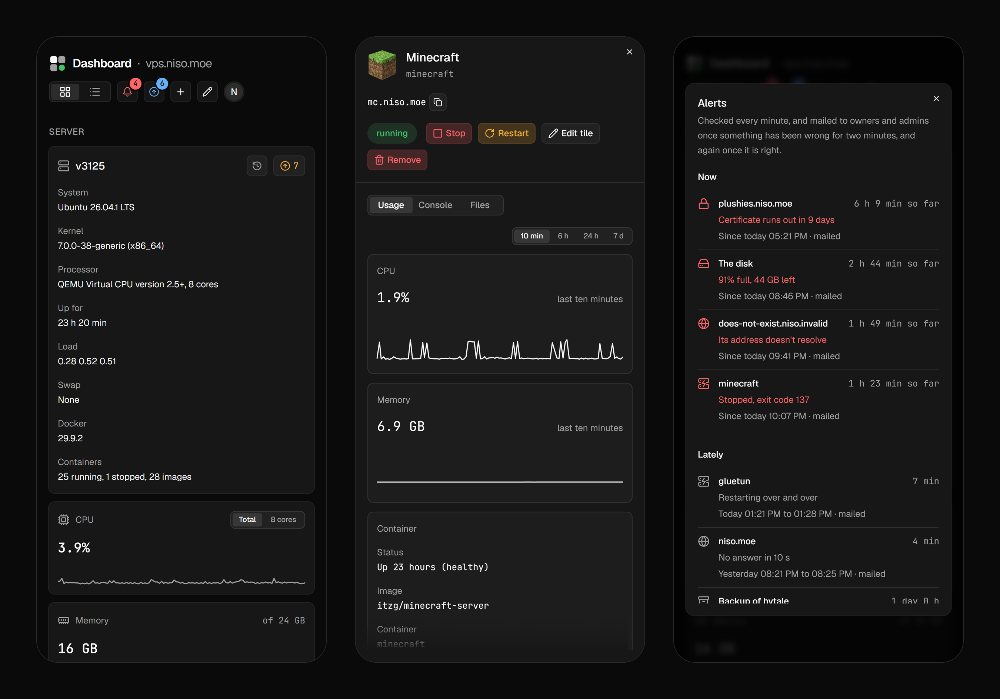

# Dashboard

[](https://github.com/CuteNikki/dash/actions/workflows/ci.yml)
[](LICENSE)

**A dashboard for one home server, that runs on it.** Every Docker container
as a tile, with its status, usage and live numbers, and a window to run it
from: logs and console, its files in an editor, its git history, and one click
to redeploy. New services come from templates and get a site in Caddy.


- **Everything on the server, at a glance.** CPU, memory, disk, network and
  processes, then every container in groups, each with a sparkline and the
  numbers its app knows: downloads in qBittorrent, players on Minecraft, sites
  in Caddy.
- **A window for each service.** Start, stop and restart it, read and type
  into its logs, edit its compose file and `.env` (checked by Compose before
  they're saved), and see what its app has to say.
- **Git, built in.** Changes, commits, branches and history, with diffs side
  by side, for every stack that's a repository, Dashboard's own included.
- **New services in a minute.** About 200 templates, any image on Docker Hub,
  a `docker run` command or a compose file of your own. Dashboard makes the folder,
  starts it, writes its Caddy site and reloads Caddy, and undoes it all if a
  step fails.
- **Updates, found and applied.** New image versions and new commits,
  checked every few hours, and applied from the dashboard: one service, or all
  of them. The server's own Ubuntu packages too, security fixes first, with a
  restart when it asks for one.
- **A record of the server.** A reading a minute, whether or not anyone's
  watching: CPU, memory, disk, network, load and how long the disk takes per
  read or write, for each service too, a week back. Every website's uptime
  over the last day, week and month, with its outages.
- **Alerts, by mail.** A service that goes down, the disk filling, a website
  that stops answering or a certificate about to run out: under the bell in
  the header, and mailed once it's lasted two minutes, and again when it's
  right.
- **Who did what.** Every start, stop, update, file saved, commit and change
  to someone's access is in the activity log, with whether it worked.
- **Its storage, browsed.** Garage's buckets as folders of thumbnails, to
  open, play or delete files from.
- **Other people, with their own access.** Invite someone by mail, and give
  them a role and the groups they see: a friend who restarts the game
  servers, a housemate who checks on the media.

## A closer look

### A service's window

CPU and memory over the last ten minutes, or as far back as a week, its
container's details and ports, and what its app reports: here, PostgreSQL's
databases.


### Its files, in an editor

The stack's folder as a tree, with files created, renamed and deleted there,
and opened in an editor with highlighting for TypeScript, YAML, Dockerfiles,
shell, TOML, `.env` and more. **Redeploy** runs `docker compose up -d` with
what was just saved; **Rebuild** builds it again first.


### Markdown, previewed

A README opens as GitHub would show it: headings, tables, task lists, alerts
such as `> [!WARNING]`, its pictures from the stack, and code blocks colored
as their language is in the editor.


### Its history, side by side

Each commit's message and files, and each file's changes either unified or
side by side, unchanged lines folded away. Fetch, pull and push are a click
each, and a stack that's behind its branch shows as an update on the
dashboard.


### Adding a service

Pick a template, search Docker Hub, paste a `docker run` command or write a
compose file. Give it an address, and its Caddy site is written for you.


### Updates, the services' and the server's

Every few hours Dashboard asks each image's registry whether its tag has a
newer image, or a newer version than the one it's pinned to, and each stack
built from a repository whether its branch has new commits. **Updates** in
the header lists them; each is applied on its own or all at once, following
what Docker and Compose print, and a new major version says so before it's
pulled.



The server's own Ubuntu packages are on its tile: what's waiting, security
fixes first, what Ubuntu is still rolling out, and a restart when the system
asks for one. An upgrade runs as a systemd job, so it carries on when Docker
restarts with it, and the window picks it up again once Dashboard is back.



### History and uptime

Dashboard keeps a reading a minute of the server and every service, whether
or not anyone has the page open, for a week. **History** on the server's tile
charts CPU, memory, disk space, disk I/O, network and load over the last hour
to the last week, and how long the disk took per read or write, where a
stall shows. A gap in a chart is a time with no readings, as while Dashboard
was down.



Each website is checked once a minute too. Its window has its uptime over
the last day, week and month, a strip of the range picked, each stretch
green, amber or red, and its outages, when each began, how long it lasted,
and why.



### Alerts

The same minute's readings are checked for what's wrong: a service that was
running and has stopped, when nobody stopped it from the dashboard; one
unhealthy or restarting for three minutes; the disk 90% full; a website
failing three checks in a row; a certificate on any address running out
within two weeks. Open ones are counted on the bell in the header. Once one
has lasted two minutes, it's mailed to owners and admins, everything from
that minute in one mail, and again when it's right. Each can turn the mail
off in Settings.



### Who did what

Starting and stopping, updates, commands typed into a console, files saved,
commits and pushes, services added and removed, the server upgraded, and
changes to people's access: each is in Settings → Activity, by whom and when,
whether it worked, and why not. Filtered by person, service or anything it
says, 90 days back.



### Browsing Garage

Garage's window has a **Browse** tab: its buckets, each folder shown by a few
of its pictures with how many files it holds and their size. A file opens
large, to look at, play or open as it is, and files are deleted one at a time
or picked together. Pictures come straight from the storage, by links signed
for the hour.



### Light or dark, tiles or a list

Every view in either theme, as the system has it or picked by hand. The list
puts each service on a row, filtered by group.


### On a phone

Everything works on a phone too: the server's tiles and every service one
under another, the header's buttons down to their icons, with how many alerts
and updates there are on their corners, and each window filling the screen.



## Apps it knows

Tiles show live numbers for Sonarr, Radarr, Prowlarr, Jellyfin, Jellyseerr,
qBittorrent, Gluetun, FlareSolverr, Stalwart, Minecraft, PostgreSQL, Garage,
Caddy and the stream relay. An app is known by its image's name, or by a
`dash.app` label on its container. Everything else gets the same tile, without
the numbers.

A container's tile starts from its [Homepage](https://gethomepage.dev) labels
(`homepage.name`, `homepage.icon`, `homepage.group`, `homepage.description`,
`homepage.href`) until it's edited in Dashboard, so a server already set up for
Homepage looks right from the start.

## How it fits together

Dashboard is a Next.js app. On the server it has the Docker socket and the home
folder mounted at the same path as on the host, so it can list and run
containers and reach their files where Compose expects them. It runs Compose
and git in short-lived containers of the official images, so its own image
needs neither.

It expects the server laid out like this:

```
~/services/
  <name>/            one folder per stack: its compose file, .env and data
  caddy/
    Caddyfile        import sites/*.caddy
    sites/<name>.caddy
```

Tiles, layouts and accounts are kept in PostgreSQL, through Prisma.
Uploaded icons go to an S3 bucket (Garage, on the same server).

With no account yet, it prints a setup code in its log; make the first
account, the owner, at `/setup` with it.

A few settings in its `.env` turn on more, each explained in `.env.example`:

| Setting                   | What it's for                                                                                                                                    |
| ------------------------- | ------------------------------------------------------------------------------------------------------------------------------------------------ |
| `SMTP_URL`, `EMAIL_FROM`  | Mail: invites, forgotten passwords, confirming an address, and alerts. The login and server as one address, `smtps://user%40example.com:…@mail…` |
| `MONITOR`                 | The record a minute behind History, uptime and alerts: on by itself where Dashboard runs in production, off in development unless `on`           |
| `SONARR_API_KEY` and more | The apps' live numbers on their tiles                                                                                                            |

## People and roles

The owner invites others from Settings → People: a link that works once, for
a day, mailed to them or copied, with the role it gives and, for the roles
that don't see everything, the groups they see. Everyone signs in with a
password or a passkey, can turn on two-factor codes from an authenticator
app, sees and signs out their own devices, and once there's mail, resets a
forgotten password from a link and confirms their address. History, alerts
and the activity log are for those who see the whole server, owners and
admins.

| Role         | Sees                     | Can                                              |
| ------------ | ------------------------ | ------------------------------------------------ |
| **Owner**    | everything               | everything, and other people's accounts          |
| **Admin**    | everything               | everything but other people's accounts           |
| **Operator** | the groups they're given | logs, start, stop and restart, and image updates |
| **Viewer**   | the groups they're given | status, usage and logs                           |

Files, git, consoles, compose, adding services and the server's own panels are
owners' and admins' alone, as any of them reaches the whole server. Every
route and action checks the role on the server, and a test fails if one
doesn't.

> [!WARNING]
> Dashboard has the Docker socket and the server's processes, so an owner or
> admin controls the server. Keep it behind HTTPS, give those roles only to
> people you'd give the server to, and use a passkey or two-factor codes.

## Developing

You need [Bun](https://bun.sh) and SSH access to the server, by the name in
`DASH_SSH_HOST` (a user name other than this machine's goes under that name
in `~/.ssh/config`). In development Dashboard still works on the real server: its
containers, files and database.

1. Install, and copy the settings. Each setting in `.env.example` says where
   to find its value.

   ```bash
   bun install
   cp .env.example .env.local
   ```

2. Once, on the server, start the helper container that lets Dashboard read the
   server's CPU, memory and processes from outside it, and set
   `HOST_HELPER_CONTAINER=dash-dev-stats`:

   ```bash
   docker run -d --name dash-dev-stats --pid host --restart unless-stopped alpine:3.22 sleep infinity
   ```

3. Open the tunnels to the server's Docker and to the apps whose numbers show
   on tiles, in a terminal of their own, and leave them running. Then start
   Dashboard and open http://localhost:3000.

   ```bash
   bun run tunnels
   bun dev
   ```

## Deploying

On the server, `~/services/dash` is a clone of this repository, following
`master`, like the other projects there. Once commits are pushed, Dashboard shows
an update for itself, and its Update pulls them and rebuilds it, restarting
Dashboard. `bun run deploy` does the same from here: it pushes `master` (with no
uncommitted changes), then pulls and runs `docker compose up -d --build` on
the server. The server's `.env` stays where it is and is never in the
repository.

Either way, the database's migrations run first, in a one-off `migrate`
container, and Dashboard only starts once they've gone through; one that fails
leaves the Dashboard that's running as it is.

## Scripts

| Script                 | What it does                                             |
| ---------------------- | -------------------------------------------------------- |
| `bun dev`              | The development server                                   |
| `bun run tunnels`      | Tunnels to the server's Docker and apps, for development |
| `bun run deploy`       | Pushes master, then pulls and rebuilds it on the server  |
| `bun run typecheck`    | Type-checks the app and the scripts                      |
| `bun run lint`         | ESLint, Tailwind classes included                        |
| `bun run lint:classes` | Tailwind classes that have a shorter way to be written   |
| `bun run format`       | Prettier                                                 |
| `bun run format:check` | Whether everything is as Prettier would write it         |
| `bun test`             | The tests                                                |
| `bun run db:diff`      | The SQL that would bring the database up to the schema   |
| `bun run db:migrate`   | Applies migrations, as each deploy does on its own       |

## Where things are

```
src/
  app/            pages and API routes
  actions/        server actions, the changes a page asks for
  components/
    auth/           sign-in, two-factor codes, setup and invites
    chrome/         the page's own: its name, theme and account menu
    dashboard/      tiles, the list, the board they're arranged on
    service/        a service's window: logs, details, status
    new-service/    adding a service, and its templates
    editor/         the file tree, code editor and Markdown preview
    git/            changes, history, branches and diffs
    host/           the server's stats, processes, disk and history
    updates/        finding and applying updates
    alerts/         the bell, and what's wrong
    storage/        browsing Garage's buckets
    settings/       your account, its security, other people's, and the activity log
    charts/         graphs and sparklines
    common/         scroll fades, toasts and loading placeholders
    ui/             buttons, dialogs, inputs and the rest
  lib/            what runs on the server, and what the browser shares with it
    apps/           each app's widget and details: Jellyfin, Sonarr, Minecraft, …
    auth/           sign-in, setup, invites, roles and the access checks
    dashboard/      the tiles, their groups, layout and status, websites' checks
    docker/         Docker's API, Compose, and runs in short-lived containers
    host/           the server's stats, processes, disk and files
    stacks/         adding and removing services, Caddy and domains
    templates/      the templates, Docker Hub search and docker run import
    updates/        checking registries and repositories, and applying updates
    monitor/        the reading a minute, and the history and uptime from it
    alerts/         what's wrong, from the monitor's readings, and mailing it
    activity/       who did what, as it's noted and read back
    mail/           sending mail, and each mail's wording
    icons/          finding icons
  test/           the tests, with their own TypeScript settings
  proxy.ts        signs in whoever isn't, before any page
prisma/         the database schema and migrations
scripts/        deploy, tunnels and the class check
docs/           the screenshots here, and the icon's drafts
```
